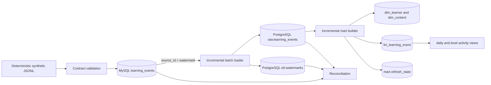

# Architecture and recovery

The generator uses UUID5 IDs tied to its seed and row number. Replaying the same file therefore hits MySQL's unique `event_id` constraint without adding new rows. MySQL `source_id` is the change cursor. Auto-increment gaps are valid; the pipeline advances to the greatest processed ID, never by a row count or event time.

The warehouse loader locks one watermark row with `FOR UPDATE`. It fetches rows strictly above that ID, ordered by `source_id`. For each row it inserts into PostgreSQL or verifies that a repeated `event_id` has identical source ID and event content. The raw inserts and watermark update occur in one PostgreSQL transaction. A database error or conflicting duplicate rolls back both. A retry starts from the old watermark.

`occurred_at` can be earlier than events already loaded. This does not affect extraction because the loader uses insertion order in MySQL. `recorded_at` is the event's source recording time; `loaded_at` is when PostgreSQL inserted it. MySQL stores UTC timestamps in `datetime(6)` without an offset; PostgreSQL stores them as `timestamptz`.

The mart builder has its own watermark and transaction. It adds missing dimension members, moves a learner's `first_seen_at` backward if a late event is earlier, inserts facts, and advances its watermark only after the fact count matches the batch. Views query the fact table, so late events change historical daily aggregates immediately after the mart refresh.

The source reconciliation compares source IDs and event IDs across both databases and checks the ingestion watermark. The mart check compares raw and fact counts, selected attributes, learner first-seen dates, daily totals, and its refresh watermark. This lab assumes the source table is append-only after insertion; update/delete capture is outside this version's scope.
